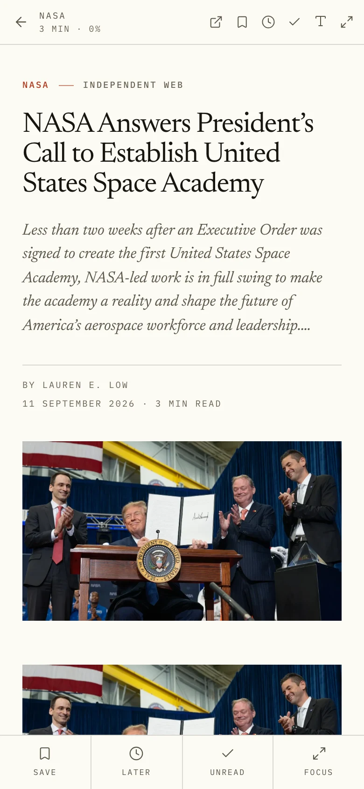

# Design

The visual language is not decoration; it is the product. This is what it is
made of, and why.

---

## Surface

Three paper tones, separated by 1px hairlines. No cards, no shadows on surfaces,
no gradients, no glass. The single exception is the popover, which needs a tight
shadow to lift it off the text underneath.

| Token    | Light     | Dark      | Role                  |
| -------- | --------- | --------- | --------------------- |
| `canvas` | `#e9e4d9` | `#0b0a09` | navigation and chrome |
| `stream` | `#f4f1e9` | `#131210` | the story column      |
| `reader` | `#fcfaf5` | `#1b1a17` | the reading surface   |

The differences are small on purpose. Stacked paper, not three panels.

## Ink

`ink` → `ink2` → `ink3` → `ink4`, calibrated so **every tier clears 5.8:1
against the darkest paper tone** — including the mono captions, which is where a
ramp usually fails. Any new colour has to clear it too.

The floor used to sit at 4.5:1, and that was the mistake: 4.5:1 is the threshold
for _legibility_, not for comfort, and on a 9.5px caption it leaves nothing in
reserve. `ink4` measured 4.70:1 and carries the bulk of the small type in the
app, so the two weakest choices compounded. The floor is now 5.84:1.

The contrast was the fix — not the size. An attempt to raise every caption below
12px was reverted: it crowded the toolbars without making anything easier to
read, because a caption is glanced at, not read. The text that carries size is
the one a reader reads.

The accent is one colour, used sparingly: unread markers, the active row's edge,
and the small state labels. It is never decorative.

## Type

Three shared faces, and one of them sets a single number. Briefing has one
additional face limited to its two mastheads.

**Newsreader** is the editorial voice:

|                                     |     |
| ----------------------------------- | --- |
| the logotype                        | 600 |
| section titles                      | 500 |
| every headline and all reading text | 400 |

Its optical-size axis (`opsz`) draws a 20px masthead and 19px body text
differently, which is what lets one serif do both. **Weight is what a logotype
needs, not a separate display family** — a high-contrast display face set at 20px
goes hairline-thin, which is what display faces do at text sizes. That is why
Instrument Serif is gone.

**IBM Plex Mono** is the metadata voice: navigation, kickers, timestamps, counts,
captions. Metadata is uppercase and widely tracked; reading text never is.

**Figtree Figures** sets the edition date numeral (`stream-column.tsx`) and
nothing else. The file is subset to the ten digits — `U+0030-0039`, 2.7KB, with
`unicode-range` declaring it — so it cannot reach text even by mistake, and it
keeps its variable weight axis so the numeral still answers `font-medium` rather
than rendering at a baked weight. Keeping it that narrow is the point: it is a
figures face, not a third voice.

The three shared faces are self-hosted from `public/fonts` and preloaded, so there is no font
CDN in the request path and the type renders identically offline. All three are
under the SIL Open Font License, which permits commercial use and web embedding
but requires the notice to travel with the files — that is
`public/fonts/OFL.txt`, and swapping a face means tending to it. Newsreader is a
variable subset; IBM Plex Mono is not (static 400 and 500, roman and italic);
Figtree is a variable subset cut down to the digits.

**None of the three carries CJK glyphs**, and that is deliberate: a CJK webfont
is megabytes for a script the device already has a good one for. The stacks fall
through to the system's own — Songti SC / SimSun / Noto Serif CJK behind the
serif, PingFang SC / Microsoft YaHei / Noto Sans CJK behind the mono — so a
Chinese gist sets in a system face beside an English headline in Newsreader. The
fallbacks are named rather than left to the generic keyword, because "serif" on
a machine without one is a lottery.

## Measure

Body text is held at **600px / about 62 characters**, and the reader offers four
steps from 17.5px to 23.5px. Long-form text gets a lede: the opening paragraph
is set slightly larger at full ink strength, which gives the piece a first beat
without the fragility of a drop cap.

In the stream, a story's description is set at **15.5px**, or **17px** in the
feature row. It is deliberately the largest text in a row after the headline:
it is what a reader scans to decide whether to open the piece, so it is where
size belongs. Everything else in a row is a caption and stays small.

## Rhythm

The stream does not render every story the same way — but **a row's shape is
earned by the story, never by its position in the feed.**

| Layout     | Use                                                   | Chosen by                          |
| ---------- | ----------------------------------------------------- | ---------------------------------- |
| `feature`  | one per edition — full-bleed plate, large headline    | authored                           |
| `standard` | headline, standfirst, 84px plate                      | the entry has a picture            |
| `compact`  | headline and a two-line standfirst                    | the default                        |
| `quote`    | a pull quote _is_ the story, behind a 2px accent rule | authored                           |
| `brief`    | contents-page row with a dotted leader                | the entry has nothing to summarise |

A positional rule would be arbitrary twice over: the same story would render
differently depending on when it was published, and a per-source "lead story"
would land at an arbitrary height in a merged, time-sorted column. Real rhythm
comes from the content — some entries have pictures, some have long standfirsts,
some have neither.

**A row may never hide a summary that exists.** A bare title reads as missing
data, not as a deliberate layout.

## Plates

The sample edition's illustrations are generated SVG, drawn deterministically
from the story id: halftone, arcs, stripes, bands, grid, hatch, horizon, numeral.

They belong to the sample edition and nothing else. A fetched article carries
artwork only when the publisher's feed supplied it; a plate in a photograph's
slot would read as the article's own image and would not exist on the page the
story links to.

## Mobile

Mobile is not the desktop stack squashed. Below 1024px the structure changes:
a compact masthead, the stream at full width, a four-item tab bar — Briefing,
Stream, Saved and Later when AI Briefing is enabled; otherwise Stream, Saved,
Later and Search. Search remains available in the masthead — and **the article as a
full-screen sheet** with its own toolbar and a four-action bar at the bottom.
Navigation moves into a drawer.

Safe-area insets are honoured top and bottom, because a full-screen reading
surface is the one place a notch actually matters.

## The briefing

The briefing follows the same paper and type rules as everything else: a serif
headline, mono metadata, hairline rules, no cards and no AI dashboard. The
middle column is the edition's contents and its history; the right pane is the
writing itself. A cited source is a mono line — publication, headline — that
opens the ordinary article reader with a clear `Back to Briefing`, returning to
the exact place in the page. Reading a briefing never marks anything read.
While a run works, the column shows real counts (`Reading sources · 3 of 8
articles checked`), never a fabricated percentage, and failures say what failed.

## One action, one control

A control lives in the column it acts on, and an action has one control — not a
second copy somewhere else.

The stream header's add, search and theme buttons are a **fallback for the
collapsed navigation**, so they appear only when the navigation is closed. Tripled
up on a wide screen they were two entry points for one action, which makes a
reader hesitate; shown only when the navigation has gone, they are the reason
that reader is not stranded.

Immersive reading acts on the **reader**, so it lives in the reader's toolbar and
nowhere else. It used to sit in the stream header too, where a "fullscreen" glyph
is ambiguous about what it expands — and it hid the very column it sat in.

The `⌘K` chip in the navigation is a **hint, not a second way in**: it teaches
the shortcut and the search icon beside it is the control. A label that is also a
button is two things pretending to be one.

## Dialogs

A dialog is capped at `86vh` with a scrolling body and a **pinned commit bar**.
A feed with a long title, a long description and five entries is taller than a
laptop window, and a primary action that scrolls out of view is an action the
reader cannot find. Both decisions live in the pinned bar — which folder it files
into, and the button that does it — so neither depends on where the body happens
to be scrolled.

## Screenshots

Four, all captured from the running app at 1440x1000 (the phone shot at
390x844):

| File                  | Shows                                                         |
| --------------------- | ------------------------------------------------------------- |
| `preview-sample.webp` | the built-in sample edition on first launch — the README hero |
| `preview-real.webp`   | a real subscription, NASA's, with its own photograph          |
| `preview-dark.webp`   | the same edition in dark mode                                 |
| `preview-mobile.webp` | the article as a full-screen reading sheet                    |

The real-feed shots use **NASA's** feed, and that is a constraint rather than a
favourite: NASA media is public domain, so a screenshot containing its
photography can live in a public repository. A news publication's pictures could
not, which rules out every other source in the suggested list.

They are WebP at quality 88 — 100-165KB each against 570KB as PNG, at a measured
41dB PSNR, which is visually lossless for a screenshot.

## Layout rule

Three columns need about **1320px** to hold a 600px measure. Below that the
navigation steps aside automatically — unless the reader has chosen a nav width
themselves, which is never overridden.

`app/globals.css` is the source of truth for all of the above.

### Briefing reading details

On phones the briefing is a continuous reading surface below its compact controls,
with four navigation tabs and an edition selector when history exists. There is one
rendered briefing reader, not duplicate desktop/mobile bodies. Desktop keeps the
contents/history column. Story headlines anchor the contents links. Narrative fields
flow as ordinary paragraphs, with a consolidated source line at the end of each
story; Big Picture retains its section kicker. Body size follows the reader preference.

Each edition retains its session scroll position when a citation is opened and on
return. The article toolbar's mobile back action returns to the briefing, and Escape
also restores it. Archive editions are labelled as archives rather than today's issue.
The masthead includes actual generation time/timezone and a measured reading estimate.
Errors use an alert, progress a live status; cancellation says a sent request may
already have been billed. No prose claims that substring validation guarantees truth.

AI Briefing uses the same On/Off switch style as Article classification. It is
off by default. Model controls and navigation appear only after opt-in; disabling
returns to Stream while retaining editions and model setup. The provider picker
uses English labels throughout, including Gemini and Custom API. Custom API's
Format selector distinguishes OpenAI-compatible from Anthropic-compatible.

AI Briefing's Written in selector reuses the existing language labels and underline
select style. It appears with the enabled model controls and changes only subsequent
editions. Reader prose follows this preference, with named-language editions marked
using HTML lang; navigation, provider labels and other application controls stay English.

Briefing prose sections establish their own positioning context. Their visually
hidden accessible headings must stay inside the reading pane's scroll area;
otherwise opening Briefing from the mobile tab can expand document scroll height
and leave a large blank area below the viewport.

The briefing's active Cancel action uses the existing spark warning accent for both
its X icon and label, keeping the same compact button style in light and dark themes.

Briefing editions use magazine hierarchy within the existing paper, serif and
hairline system: a larger issue masthead, an opening Big Picture, serif section
headings and stronger section rules. The first news item in the editor's supplied
order gets the lead headline size; subsequent news stays quieter. Worth Reading
uses compact numbered entries, recommendation copy and a source link without
repeating the article title. The page stays single-column on mobile, preserves
reader font size/citation return positions and keeps accessible headings inside
positioned sections. These styles also apply to saved editions without regeneration.

Consolidated news citations also merge every paragraph's evidence IDs at display
time, so older editions with incomplete cached source lists retain their links.

Briefing Chinese headlines and prose insert a single space at Han–Latin and
Han–Arabic-number boundaries, including contents links and recommendation text.
Display formatting also improves saved editions without rewriting their records.
URLs, email addresses, code spans, source identifiers and evidence excerpts remain
verbatim. Explicit Japanese/Korean editions and text containing their scripts are
left unchanged. New model prompts request the same Chinese spacing convention.

Briefing controls distinguish the saved edition from unfinished work. A newer
incomplete task displays its revision and next stage, with Resume rN as the
primary action. With no saved edition, the secondary action is Start over;
otherwise the existing Regenerate/Generate action stays available. A saved
edition is explicitly marked Saved. Older attempts disappear from these controls
once a newer edition succeeds; dates/timezones distinguish a selected archive
from today's unfinished work. Errors and live generation progress stay separate.

The desktop briefing contents begin with a roman serif Big Picture entry,
followed by separate mono-labelled Top Stories and Worth Reading groups, without
a redundant contents title. Numbered rows
and hairline separators distinguish adjacent headlines, with wrapped text aligned
under the headline rather than its number. Archive rows always reserve the same
left border and padding; selection changes the rule and ink without shifting text.

Focus topics now describe the briefing's content scope: selected topics restrict
new editions to directly relevant material, while an empty selection produces a
general briefing. The settings helper makes this explicit; fewer stories are
preferred to unrelated filler. Existing editions and frozen old runs keep their
original content.

The desktop briefing history is anchored below the independently scrolling
contents. Switching between short and long editions never moves the history
heading or its rows. History occupies at most 40% of the available area below
the controls and scrolls internally when more editions exist; the remaining
height belongs to contents. Mobile retains the compact edition selector.

Earlier editions is collapsed by default behind a compact footer toggle with
its version count. Opening it reveals the independently scrolling history;
switching editions keeps it open and preserves its position.

The briefing masthead gives the word Briefing the existing spark brand ink,
with a restrained tinted rule beneath the issue metadata. Section counts and
Worth Reading numerals repeat the same accent; prose, article headlines and
paper surfaces retain the established reading palette in both themes.

New daily briefings show a compact Coverage line below the generation metadata,
with the frozen start/end dates and times in the issue timezone. The issue date
is its daily filing date, while this range explains its rolling 24-hour contents.
Legacy editions without an explicit range keep their existing masthead metadata.

Briefing mastheads alone use locally hosted **Lora**, regular 400,
with Tailwind `font-briefing-title` and `tracking-[0.015em]`. Its license is in
`public/fonts/lora-variable-OFL.txt`. This face is loaded on demand, without a
site-wide preload or a remote font request. Newsreader remains the face for
Briefing prose, story headlines, section titles, the logo, and other pages.
Other serif titles use normal spacing. Prose uses a subtle `0.005em` spacing;
uppercase metadata keeps its existing wide tracking.
Briefing text disables font ligatures so pairs such as `fi` in the masthead
remain separate letterforms in both the contents column and reading pane.

During Briefing generation, the live stage label has the existing small spark
Firefly breathing dot and a brief fade when the stage changes. Detail counts
update without restarting the fade. The existing reduced-motion rules disable
both animations; stages and counts remain the actual pipeline state.
